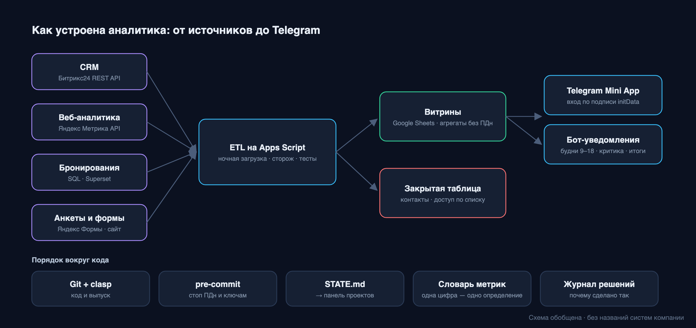
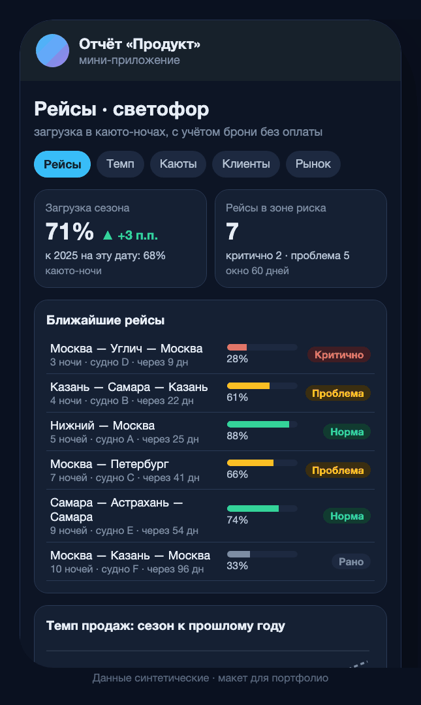
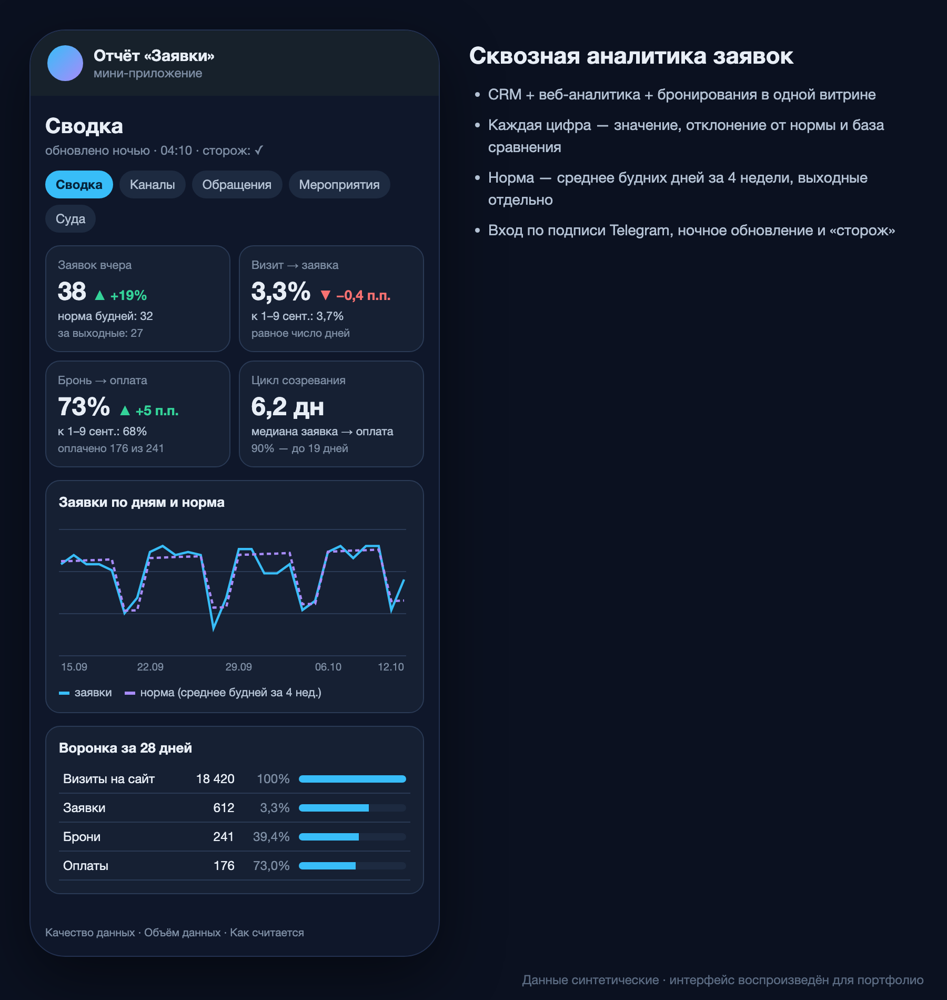
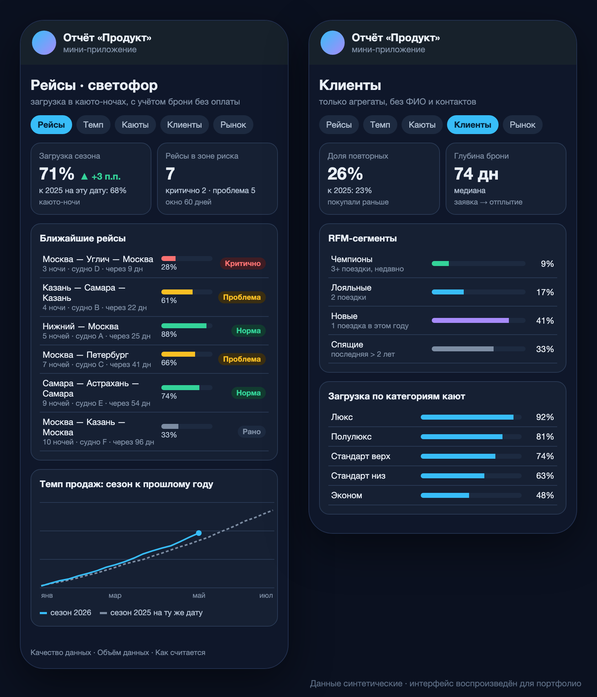
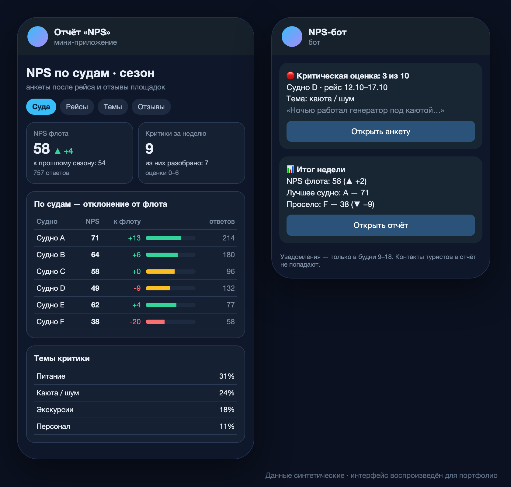
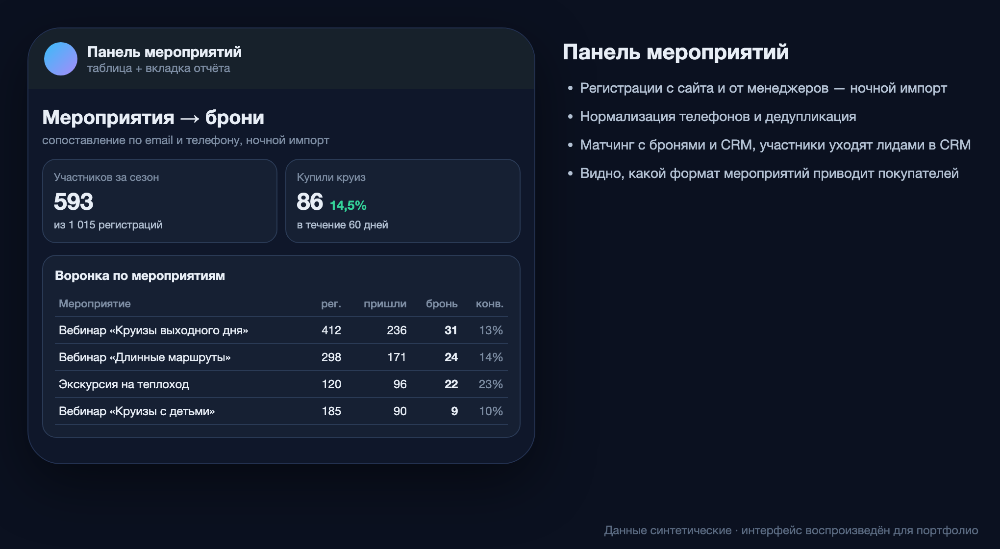
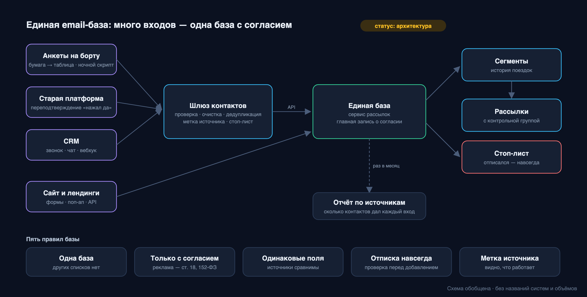

# Portfolio
# 👋 Привет! Меня зовут Александр Чернецов

## 📊 Аналитик данных | Продуктовая аналитика | BI

---

## 🎯 Обо мне

**8+ лет** в B2B-продажах и управлении IT-проектами → **осознанный переход в аналитику данных**

За плечами:
- ✅ **557 часов** практики в Яндекс Практикуме
- ✅ Сейчас — аналитик в B2C-туризме: продуктовая аналитика (загрузка, темп продаж YoY, RFM, конкуренты), сквозная аналитика, NPS
- ✅ Реальные проекты с дашбордами и аналитикой
- ✅ Глубокое понимание бизнес-процессов изнутри

**Моя философия:** чтобы цифры работали, нужно отлично понимать бизнес изнутри. Я не просто строю графики — я решаю бизнес-задачи.

---

## 🛠 Технический стек

### BI & Визуализация

### Базы данных & Big Data

### Программирование

### Автоматизация & Интеграции

### Веб-аналитика & CRM-маркетинг

### CRM & Инструменты

---

## 💼 Ключевые проекты

### 🚢 Текущая работа: аналитика туроператора речных круизов (2026)
> Компания и данные не раскрываются по NDA. Подробные обезличенные кейсы — в папке [projects](projects/).

<table><tr>
<td></td>
<td></td>
</tr><tr>
<td></td>
<td></td>
</tr><tr>
<td colspan="2"></td>
</tr></table>

*Скриншоты — макеты интерфейсов на синтетических данных.*

| Кейс | Суть | Стек |
|---|---|---|
| [Сквозная аналитика заявок](projects/01-lead-analytics/) | CRM + Метрика + бронирования → ежедневный отчёт в Telegram Mini App, 60+ релизов | `Apps Script` `Bitrix24 API` `Метрика API` `SQL` |
| [NPS и отзывы](projects/02-nps-reviews/) | NPS по судну и рейсу, алерты о критике, разделение ПДн и аналитики | `Apps Script` `Яндекс Формы` `Telegram Bot API` |
| [Продуктовая аналитика](projects/03-product-analytics/) | Загрузка в каюто-ночах, светофор рейсов, темп продаж YoY, RFM и повторные покупки, сравнение с конкурентами | `SQL` `Superset` `Apps Script` |
| [Панель мероприятий](projects/04-events-panel/) | Воронка «регистрация → бронь» для вебинаров и экскурсий | `Apps Script` `Bitrix24` |
| [Единая email-база](projects/05-crm-email-base/) | Аудит согласий (152-ФЗ), архитектура базы, сегменты, механика возврата | `Mindbox` `DashaMail` |
| [«Штаб аналитики»](projects/06-analytics-hq/) | Git, словарь метрик, pre-commit защита от утечки ПДн и ключей | `Git` `Python` |

---

### 📈 BI-дашборд для коммерческого отдела (Кайтен Софтвер)
**Проблема:** Руководство не видело ключевые метрики в реальном времени

**Решение:**
- Спроектировал систему сводных дашбордов в DataLens
- Настроил анализ данных из CRM Kaiten
- Разработал отчетные модели в Excel/Google Sheets

**Результат:**
- Динамика продаж, выполнение планов, конверсии воронки
- Средний чек, цикл сделки
- Выявление узких мест в процессах

**Стек:** `DataLens` `SQL` `Excel` `Kaiten CRM`

---

### 🤖 Автоматизация бизнес-процессов (n8n + Bitrix24)
**Проблема:** Ручной сбор данных из разных источников занимал много времени

**Решение:**
- Настроил автоматическую интеграцию через n8n/Make
- Интегрировал Bitrix24 с внешними API
- Создал кастомную отчетность в Bitrix24

**Результат:**
- Сокращение времени на рутинные задачи
- Автоматическая синхронизация данных
- Прозрачная система контроля для клиентов

**Стек:** `n8n` `Make` `Bitrix24 API` `REST API`

---

### 📊 Аналитика эффективности команды
**Проблема:** Не было прозрачности по загрузке и производительности команды

**Решение:**
- Собрал и визуализировал метрики: velocity, % задач в срок
- Настроил регулярную отчетность по KPI
- Подготовил рекомендации по оптимизации

**Результат:** Выявлены узкие места и точки роста

**Стек:** `Python` `Pandas` `Matplotlib` `Superset`

---

## 🏆 Достижения и сертификаты

### 🎓 Образование
- **Яндекс Практикум** — Аналитик данных расширенный
  - 557 часов практики
  
- **АНО ДПО «Академия Пять призм»** — Коучинг международного уровня 

### 🏅 Статусы
- **Партнер 1С-Битрикс** 
  - Бизнес-партнер по «1С-Битрикс24»
  - Бизнес-партнер по «1С-Битрикс: Управление сайтом»
  - [Проверить статус](https://www.1c-bitrix.ru/partners/check_partner.php)

### 📝 Рекомендации
> *"Аналитические дашборды отличались структурированностью и были востребованы при принятии управленческих решений"*

**Руководитель группы**, ООО «Кайтен Софтвер» — контакт для рекомендации по запросу

---

## 📂 Портфолио проектов

### Учебные проекты Яндекс Практикума
1. **Исследовательский анализ данных (EDA)**
2. **A/B тестирование и проверка гипотез**
3. **Построение витрин данных**
4. **Визуализация данных в DataLens/Superset**

### Реальные кейсы
- [Обезличенные кейсы текущей работы](projects/)
- [Пет-проект: торговый бот TON](projects/07-ton-trading-bot/)
- Дашборды для коммерческих отделов
- Автоматизация отчетности
- Интеграции CRM-систем

---

## 💡 Что я умею

### Анализ данных
- ✅ Исследовательский анализ данных (EDA)
- ✅ A/B тестирование
- ✅ Проверка статистических гипотез
- ✅ Работа с бизнес-метриками (Retention, LTV, Churn, конверсии)

### Продуктовая аналитика
- ✅ Продуктовые метрики и их методика: загрузка, темп продаж, глубина бронирования
- ✅ Когортный анализ, RFM-сегментация, повторные покупки
- ✅ Сравнение год к году и с конкурентами, сигналы об отклонениях
- ✅ Словарь метрик: одна цифра — одно определение

### Работа с данными
- ✅ SQL (SELECT, JOIN, GROUP BY, подзапросы, агрегации)
- ✅ ClickHouse (аналитические запросы)
- ✅ Python (pandas, NumPy, визуализация)
- ✅ Excel/Google Sheets (сводные таблицы, Power Query)

### BI & Визуализация
- ✅ Построение дашбордов в DataLens, Superset, Power BI
- ✅ Проектирование систем отчетности
- ✅ Визуализация сложных данных

### Автоматизация
- ✅ Настройка workflows в n8n, Make
- ✅ Интеграции через REST API
- ✅ ETL-процессы
- ✅ Telegram-боты и Mini App как интерфейс отчётов

### Soft Skills
- ✅ Понимание бизнес-процессов
- ✅ Работа с требованиями заказчика
- ✅ Перевод бизнес-задач на технический язык
- ✅ Управление проектами (Agile/Scrum)

---

## 📬 Контакты

Готов к сотрудничеству и интересным проектам!

- 📧 **Email:** [job.tpk@yandex.ru](mailto:job.tpk@yandex.ru)
- 💬 **Telegram:** [@AleksandrChernetsov](https://t.me/AleksandrChernetsov)
- 📍 **Локация:** Санкт-Петербург (готов к удаленной работе)

---

## 🎯 Цель

Ищу позицию **аналитика данных / BI-аналитика**, где смогу:
- Применять свои технические навыки (SQL, Python, BI)
- Решать реальные бизнес-задачи
- Расти профессионально в области data-driven решений

---

*Последнее обновление: Октябрь 2026*
