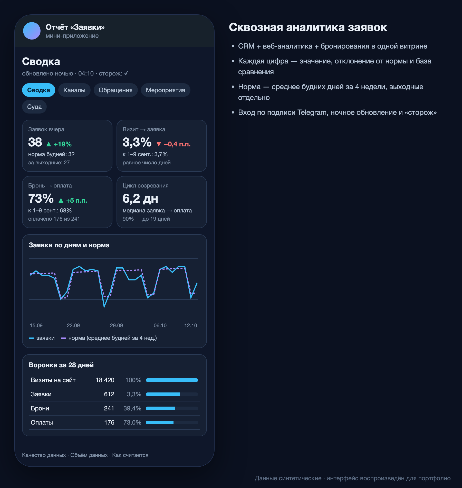

# Сквозная аналитика заявок в Telegram Mini App

> Компания: туроператор речных круизов (B2C, сезонный спрос). Название, данные и интерфейсы скрыты по NDA — описаны подход и решения.

*Интерфейс воспроизведён на синтетических данных: реальные цифры и названия не показываются.*

## Задача
Руководство и отдел продаж каждый день собирали картину «сколько заявок, откуда, сколько дошло до оплаты» вручную из CRM, веб-аналитики и системы бронирования. Цифры в разных выгрузках не сходились.

## Решение
- **Источники:** CRM Битрикс24 (лиды и обращения, REST API), Яндекс Метрика (визиты, ClientID, API отчётов), система бронирования, BI-витрины в Superset (SQL).
- **ETL на Google Apps Script:** ночная загрузка и пересчёт, «сторож», который сообщает, если обновление не прошло.
- **Витрина:** заявки → брони → оплаты, конверсия «визит → заявка», цикл созревания заявки, вкладки по каналам, судам и мероприятиям.
- **Интерфейс:** Telegram Mini App (веб-приложение Apps Script в обёртке на GitHub Pages). Доступ проверяется по подписанным данным Telegram (`initData`) и белому списку.
- **Подача цифр:** карточка = значение + отклонение от нормы. Норма — среднее будних дней за 4 недели, выходные считаются отдельно, периоды сравниваются при равном числе дней.
- **Уведомления** в Telegram только в рабочие часы, чтобы не превращаться в шум.
- **Когорты:** «кем был человек в день заявки и когда купил» с фильтром по типу клиента (частные лица, ИП, самозанятые, агентства); результаты сверены с SQL-запросом.
- **Конверсия сайта по неделям** (заявки с сайта / визиты) и «сторож» на случай, если сайт перестал принимать заявки.
- **Попапы сайта:** вкладка по данным API сервиса попапов — показы, клики, закрытия, CTR, уровни «тема → кампания → вариант», фильтры «и / или / кроме» по 13 срезам, время до действия. Цифры сверены с реестром попапов до единицы.
- **Мероприятия:** воронка «регистрация → лид в CRM → заявка → оплата», когорта «купили после мероприятия», места по сеансам экскурсии по статусам броней (подробнее — [Панель мероприятий](../04-events-panel/)).
- **Скорость и надёжность:** отчёт открывается сразу из копии на устройстве, кэш прогревается заранее; если источник ночью не обновился, сводка пишет «нет данных», а не 0. Коридор прогноза проверен тем же расчётом на прошлых месяцах.
- **Вход из браузера** через Telegram Login, единый список доступа для всех отчётов.

## Результат
- Ежедневный отчёт вместо ручной сводки; 160+ релизов по обратной связи пользователей.
- Одно определение каждой метрики в словаре — расхождения между отчётами сняты.
- Ключи и вебхуки вынесены из кода в свойства скрипта.

**Дальше:** атрибуция каждой заявки к рекламному каналу по ClientID и расчёт стоимости заявки.

**Стек:** `Google Apps Script` `Bitrix24 REST API` `Яндекс Метрика API` `REST API` `SQL` `Superset` `Telegram Mini App` `GitHub Pages`
