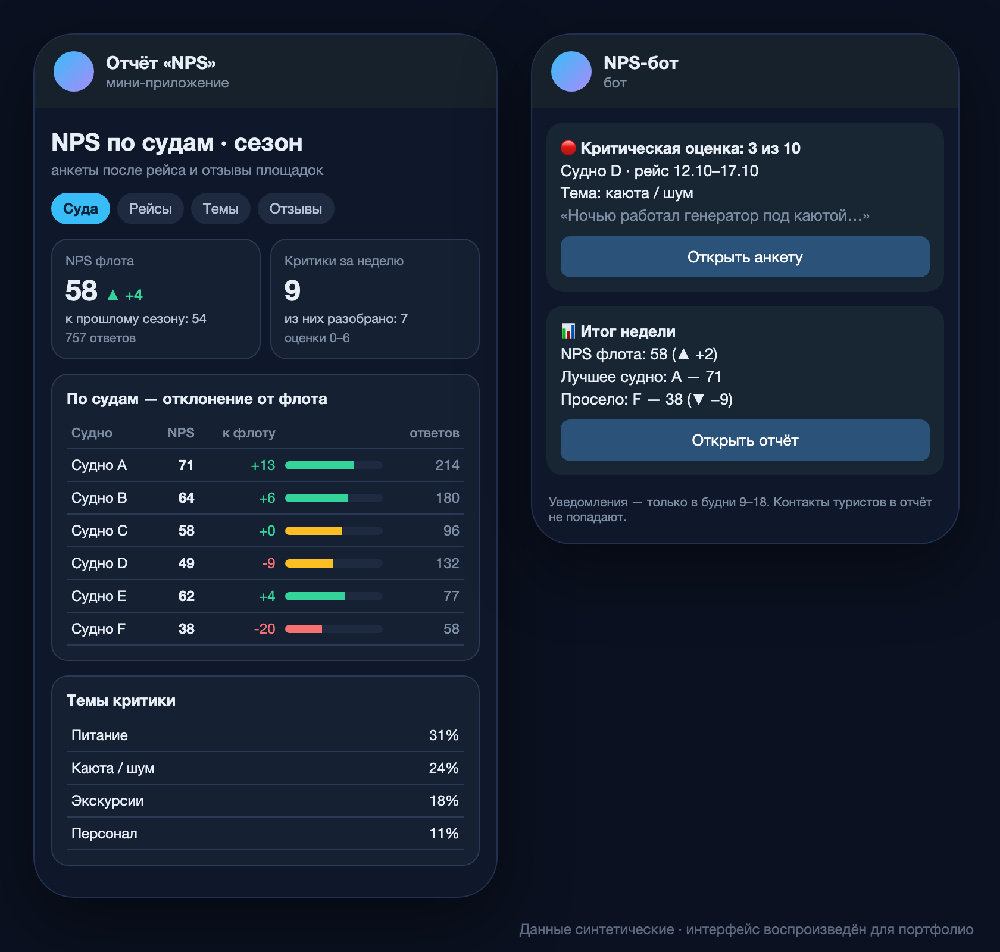

# NPS и отзывы туристов

> Компания: туроператор речных круизов. Данные клиентов в репозиторий не попадают; примеры ниже — схематичные.

*Интерфейс воспроизведён на синтетических данных: реальные цифры и названия не показываются.*

## Задача
Анкеты после рейса и отзывы на внешних площадках жили отдельно. Не было ответа на вопрос «на каком судне и рейсе проседает качество» и способа быстро реагировать на критику.

## Решение
- Сбор ответов анкет и отзывов с площадок в одну модель: турист → рейс → судно → сезон. Публичные отзывы собираются раз в месяц, в том числе из раздела отзывов сообществ ВКонтакте.
- Расчёт NPS по судну, рейсу и сезону с отклонением от среднего по флоту и количеством ответов (чтобы не делать выводов по 3 анкетам).
- **Статистическая значимость:** судно подсвечивается как «ниже / выше флота» только при разнице больше двух стандартных ошибок NPS; при малом числе ответов — серым.
- Оценки отдельных пунктов анкеты (например, работа официантов) считаются как индекс по методике NPS, а не средний балл.
- Мгновенное уведомление о критической оценке в Telegram с кнопкой «Открыть анкету»; только в будни в рабочее время.
- Отчёт в Telegram Mini App, вход из браузера через Telegram Login, совместимость с Android и Windows; карточки ведут к подробным блокам, единый период отзывов на всех вкладках.
- Сравнение собственной схемы на Яндекс Формах с сервисом анкет внешнего подрядчика.

## Работа с персональными данными (152-ФЗ)
- Контакты туристов отделены от аналитики: в отчёте — агрегаты и обезличенные ID, контакты — в закрытой таблице с ограниченным доступом.
- Доступ к отчёту только по белому списку — общему для всех отчётов, с ролями и настройкой уведомлений.

## Результат
77 версий отчёта; команда видит слабые рейсы и получает сигнал о негативе в день ответа, а не в конце сезона.

**Стек:** `Google Apps Script` `Google Sheets` `Яндекс Формы` `SQL` `Telegram Bot API` `Telegram Mini App`
