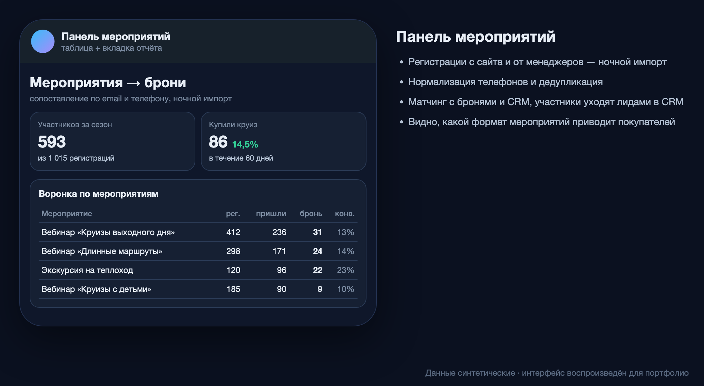

# Панель вебинаров и офлайн-мероприятий

> Компания: туроператор речных круизов.

*Интерфейс воспроизведён на синтетических данных: реальные цифры и названия не показываются.*

## Задача
Компания проводит вебинары и экскурсии на теплоход для привлечения покупателей. Было непонятно, сколько участников потом бронирует круиз.

## Решение
- Ночной импорт регистраций (формы сайта на Tilda, заявки менеджеров).
- Сопоставление участника с бронированиями и CRM по email и телефону (нормализация телефонов, дедупликация).
- Отдельный учёт гостей по действующим броням.
- Передача участников в Битрикс24 как лидов; вкладка «Мероприятия» в общем отчёте по заявкам.
- Участники = регистрации + лиды CRM без регистрации (по CRM-форме вебинара); перед мероприятием сверка с CRM идёт и днём, каждые 15 минут, а не только ночью.
- Экскурсия на теплоход: места по сеансам с учётом статусов броней (какие статусы держат места — зафиксировано решениями и сверено с картой мест системы бронирования), «сторож» мест с уведомлениями не чаще раза в час.
- Конверсии «в оплату» и «в бронь» в карточках, когорта «купили после мероприятия» — от дня сеанса каждого человека.

## Результат
Для каждого мероприятия видна воронка «регистрация → участие → бронь → оплата»; гости экскурсии считаются по тем же правилам, что и в системе бронирования.

**Стек:** `Google Apps Script` `Google Sheets` `Bitrix24 REST API` `Tilda`
