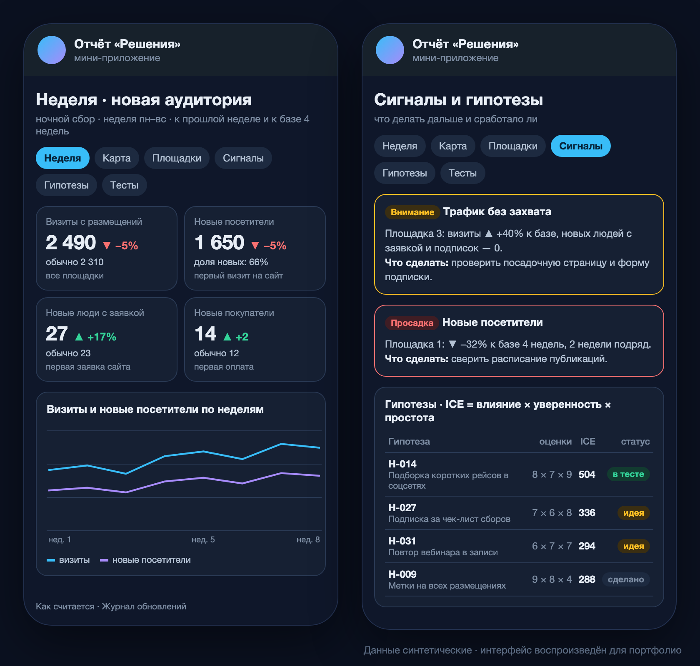

# Поддержка решений: гипотезы, тесты, сигналы

> Компания: туроператор речных круизов. Названия площадок, гипотезы и цифры скрыты; описаны методика и устройство. **Статус: запущено в октябре 2026**, 6 версий; метрики подписки и стоимости привлечения — в разработке (ждут сервиса рассылок и данных о расходах).

*Интерфейс воспроизведён на синтетических данных: реальные цифры, площадки и гипотезы не показываются.*

## Задача
Отчёты по заявкам, NPS и продукту отвечают на вопрос «что происходит». Не хватало ответа на «что делать дальше и сработало ли»: гипотезы роста жили в разрозненном списке, эффект от размещений на внешних площадках никто не мерил по неделям, а просадки замечали поздно.

## Решение
- **Метрики новой аудитории:** для каждой метрики карточка определения (что считаем, единица, период, источник) согласована до первой цифры. В работе: визиты с наших размещений, новые посетители по площадкам, новые люди с первой заявкой, новые покупатели с первой оплатой. Подписки, конверсия в подписку и стоимость нового покупателя описаны и ждут источников.
- **Ночной сбор:** Яндекс Метрика API (по площадкам, сверка строк с итогом, повтор при ограничении запросов) и SQL из системы бронирования через Superset; неделя пн–вс, пересчёт последних трёх полных недель.
- **Сигналы с рекомендацией:** правила по отклонению от прошлой недели и базы 4 недель, например «трафик без захвата» — визиты растут, а заявок и подписок нет. У каждого сигнала есть «что сделать».
- **Реестр гипотез и тестов:** ICE-оценка (влияние × уверенность × простота), статус, карточка гипотезы; тесты — против контрольного периода.
- **Карта-воронка** «площадки → сайт → заявка → почта» с конверсиями между уровнями; на телефоне — список карточек вместо широкой схемы.
- **Продукт:** Telegram Mini App (вход по подписи Telegram или Telegram Login из браузера, доступ по общему списку), бот с командами (неделя, сигналы, тесты, гипотезы) и сводкой по пятницам.

## Результат
- Первый автоматический прогон совпал с ручным расчётом по тем же неделям цифра в цифру.
- Гипотезы из разрозненного списка перенесены в один реестр с единой оценкой.
- Логика расчётов покрыта тестами на Node с имитацией окружения Apps Script — правки проверяются до выпуска.

**Стек:** `Google Apps Script` `Яндекс Метрика API` `SQL` `Superset` `Node.js` `Telegram Mini App` `Telegram Bot API` `clasp`
