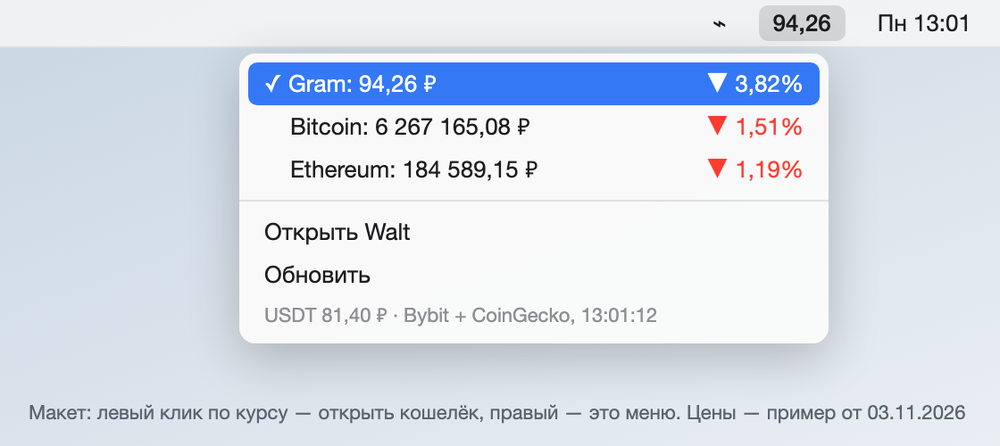

# Пет-проект: курс криптовалют в строке меню Mac

> Личный проект на один вечер. **Статус: работает каждый день.** Код целиком в [`src/`](src/).

## Задача
Следить за курсом Gram (бывший Toncoin), не открывая Telegram-кошелёк, и чтобы цифра совпадала с тем, что показывает кошелёк.

## Решение
Плагин для [SwiftBar](https://github.com/swiftbar/SwiftBar): скрипт на Python раз в минуту печатает курс, SwiftBar выводит его в строку меню.

- **Сверка с эталоном.** Первая версия брала рубли у агрегатора и расходилась с кошельком на ~0,7%. Оказалось, что агрегатор считает по курсу ЦБ, а кошелёк — как биржевая цена к USDT × рыночный курс USDT/RUB. После перехода на ту же формулу (Bybit × CoinGecko) расхождение упало до 0,1–0,2%.
- **Отказоустойчивость.** Запасная биржа (OKX), если основная не ответила; последний удачный курс USDT кэшируется, поэтому при лимите запросов API цифра не пропадает.
- **Несколько монет.** Gram, Bitcoin, Ethereum и сам курс USDT к рублю; монету для строки меню выбирают кликом в меню, выбор хранится в файле. Новая монета — одна строка в словаре.
- **Выбор валюты.** Цены в рублях или долларах (знак валюты в строке меню), выбор в выпадающем списке; в подменю у каждой монеты — цена во второй валюте.
- **Два действия на одной кнопке.** Левый клик по курсу открывает мини-приложение кошелька в Telegram, правый — меню с ценами, изменением за 24 часа и временем обновления.
- **Без дублей окон.** Повторное открытие ссылки добавляло в окно кошелька новую вкладку. Скрипт через Accessibility API находит уже открытое окно и выводит его вперёд; нужное окно отличил по журналу с названиями и размерами окон.

## Результат
Курс всегда на виду и совпадает с кошельком. Отдельный урок — сначала найти, как считает эталон, и только потом подбирать источник данных.

**Стек:** `Python` `Bash` `AppleScript` `SwiftBar` `REST API (Bybit, OKX, CoinGecko)` `macOS Accessibility`
